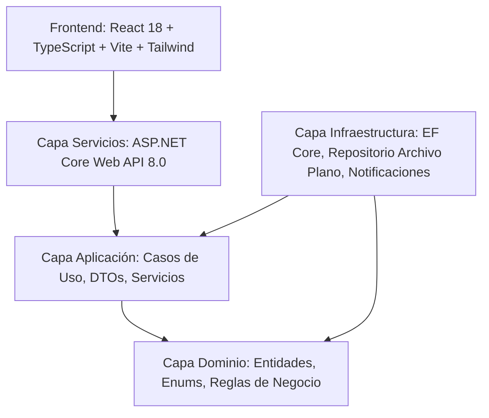

# Arquitectura del Sistema · SB Gestión de Solicitudes Internas

Este documento describe las decisiones de arquitectura, diseño técnico y separación de responsabilidades adoptadas para el desarrollo de la solución empresarial de la **Superintendencia de Bancos de la República Dominicana (SB)**.

---

## 1. Visión General y Estilo Arquitectónico

La solución implementa una **Onion Architecture** (Arquitectura Cebolla) desacoplada y orientada al dominio, estructurada en capas concéntricas con regla de dependencia hacia el centro:

### Proyectos de la Solución .NET 8

1. **`SB.GestionSolicitudes.Dominio`** (Núcleo)
   - Contiene los modelos de dominio (`Solicitud`, `HistorialEstado`, `Comentario`, `Notificacion`, `Usuario`, `Area`, `TipoSolicitud`, `EntidadGubernamental`).
   - Define enumeraciones de negocio (`EstadoSolicitud`, `PrioridadSolicitud`, `RolUsuario`, `VisibilidadComentario`, `CanalNotificacion`).
   - Contiene lógica de dominio invariante (transiciones válidas de ciclo de vida, validación de comentario obligatorio para cierre, asignación de responsables y generación del código con formato `SOL-YYYY-XXXX`).
   - **Cero dependencias externas**.

2. **`SB.GestionSolicitudes.Aplicacion`** (Casos de Uso)
   - Define las interfaces de contratos (`ISolicitudRepositorio`, `IEntidadGubernamentalRepositorio`, `IUsuarioRepositorio`, `INotificadorSolicitud`, `IUnidadDeTrabajo`, `IGeneradorTokenJwt`, `IServicioHashContrasena`, `IUsuarioActual`, `IReloj`).
   - Implementa los servicios de aplicación (`SolicitudServicio`, `EntidadGubernamentalServicio`, `AutenticacionServicio`, `TableroServicio`, `CatalogoServicio`, `UsuarioServicio`).
   - Define contratos DTO de entrada y salida con validación estricta y uso del patrón **Result** (`Resultado<T>`, `ErrorAplicacion`) para evitar el uso de excepciones como control de flujo.

3. **`SB.GestionSolicitudes.Infraestructura`** (Adaptadores Externos)
   - Implementa persistencia relacional con **Entity Framework Core 8** sobre **SQL Server** (`ContextoBaseDatos`, migraciones versionadas y mapeos Fluent API). El arranque aplica las migraciones pendientes y la semilla de demostración.
   - Implementa el repositorio de **Base de Datos en Archivo de Texto Plano** (`RepositorioEntidadesGubernamentalesArchivo`) para las **Entidades Gubernamentales de la República Dominicana**, cumpliendo el requerimiento estricto del documento de especificaciones técnicas.
   - Mecanismo de notificaciones multicanal extensible (`NotificadorSolicitud`, `CanalBaseDatosNotificacion`, `CanalCorreoSimuladoNotificacion`, `CanalConsolaNotificacion`).
   - Generación y validación de tokens JWT (`GeneradorTokenJwt`) y hashing seguro de contraseñas mediante PBKDF2-SHA256 (`ServicioHashContrasena`).

4. **`SB.GestionSolicitudes.Servicios`** (Punto de Entrada Web API)
   - Controladores RESTful (`SolicitudesController`, `EntidadesGubernamentalesController`, `AutenticacionController`, `DashboardController`, `CatalogosController`, `UsuariosController`).
   - Manejador global de excepciones (`ManejadorExcepciones`, `IExceptionHandler`) y páginas de código de estado que devuelven `application/problem+json` conforme a **RFC 9457** (Problem Details), con los miembros de extensión `codigo` (código de negocio estable) y `trazabilidad` (correlación con los logs y la cabecera `X-Trace-Id`).
   - Documentación dual con **Swagger / OpenAPI** en `/swagger` y **Scalar** en `/docs/v1`.
   - Pipeline de logging estructurado con **Serilog** a consola y archivos rotativos (`logs/sb-gestion-solicitudes-.log`).
   - Health check en `/salud`.

5. **`SB.GestionSolicitudes.Pruebas`**
   - 146 pruebas automatizadas: pruebas unitarias de dominio, repositorios, servicios de aplicación y pruebas de integración con `WebApplicationFactory` simulando requests HTTP reales.

---

## 2. Estrategia de Persistencia Dual

Para satisfacer fielmente ambos pliegos de requerimientos:

| Requerimiento | Documento de Origen | Solución Implementada |
| :--- | :--- | :--- |
| **Mantenimiento de Entidades Gubernamentales** | *API - Especificaciones Técnicas* | **Archivo de texto plano JSON** (`database/entidades-gubernamentales.json`), ubicado en el mismo proyecto, cargado inicialmente desde `ListaEntidadesGubernamentales.xlsx` y con operaciones completas de lectura, filtrado, creación, actualización y borrado concurrente con semáforo asíncrono. |
| **Gestión de Solicitudes Internas y Auditoría** | *Prueba Técnica Full Stack* | **Base de Datos Relacional SQL Server con EF Core 8**, con migraciones versionadas, índices de cobertura para filtros/paginación, integridad referencial mediante claves foráneas y scripts T-SQL de referencia (`database/schema.sql` y `database/seed.sql`). |

### Resiliencia de conexión y aislamiento de pruebas

- **Reintentos ante arranques fríos:** el `DbContext` se registra con `EnableRetryOnFailure` (6 intentos, espera máxima de 10 segundos entre ellos). Un SQL Server recién creado puede seguir en fase de recuperación cuando el API ya está arrancando; sin reintentos, la primera consulta tumba el proceso y con él la sonda `/salud`. La semilla se ejecuta dentro de `CreateExecutionStrategy()` para que un reintento no invalide su transacción.
- **Primer arranque con base inexistente:** antes de crear el catálogo, EF Core comprueba si existe abriendo una conexión contra él, y SQL Server deja en su log uno o dos `Error 18456, State 38` (*Failed to open the explicitly specified database*). Es ruido esperado del motor, no un fallo de credenciales: la base se crea acto seguido, la migración se aplica y los arranques posteriores no lo repiten.
- **Aislamiento por prueba:** cada fábrica de integración (`FabricaAplicacionWeb`) crea una base desechable `SbPruebas_<guid>` y la elimina al liberarse. La instancia la levanta **Testcontainers** (un único contenedor `mcr.microsoft.com/mssql/server:2022-latest` por corrida, compartido por todas las pruebas); si existe `ConnectionStrings__BaseDatosPruebas`, se usa esa instancia y el contenedor no se crea. Las pruebas corren en paralelo sin tocar la base del desarrollador ni compartir estado entre sí.

---

## 3. Seguridad y Control de Acceso por Roles (RBAC)

El sistema implementa autenticación basada en **JSON Web Tokens (JWT)** firmados con algoritmo HMAC-SHA256 y autorización en backend basada en políticas y roles:

- **`Administrador`**: Acceso total al sistema, gestión de usuarios, catálogos, mantenimiento de entidades gubernamentales, y re-apertura de solicitudes cerradas.
- **`Analista`**: Gestión de solicitudes disponibles o asignadas, cambios de estado, asignación de responsables, agregar comentarios internos y públicos, y re-apertura de solicitudes cerradas.
- **`Solicitante`**: Registro de solicitudes, seguimiento de solicitudes propias, y comentarios públicos.

---

## 4. Patrones de Diseño Aplicados

1. **Onion Architecture / Clean Architecture**: Desacoplamiento total entre infraestructura y lógica de negocio.
2. **Repository & Unit of Work**: Abstracción del acceso a datos que permite alternar motores de persistencia sin alterar casos de uso.
3. **Result Pattern**: Respuestas tipadas de éxito o error de dominio (`Resultado.Exito`, `Resultado.Falla`), reduciendo sobrecosto de excepciones.
4. **Strategy / Channel Pattern para Notificaciones**: `INotificadorSolicitud` distribuye eventos a múltiples implementaciones de `ICanalNotificacion`. Agregar un canal de colas (RabbitMQ / Azure Service Bus) solo requiere crear una clase sin modificar el flujo de negocio.
5. **Dependency Injection**: Inversión de control estricta con registro modular por capa (`AgregarAplicacion()`, `AgregarInfraestructura()`).

---

## 5. Despliegue en Contenedores

La plataforma se empaqueta en dos imágenes multi-etapa propias (API y web) más el contenedor oficial de SQL Server, orquestados por Docker Compose en tres entornos (`compose.yaml`, `compose.dev.yaml` y `compose.test.yaml`).

| Aspecto | Decisión | Motivo |
| :--- | :--- | :--- |
| **Imagen del API** | Etapas `dependencias` → `origen` → `publicacion` / `pruebas` / `desarrollo` → `final` | El artefacto publicado no arrastra el SDK; restaurar solo los `.csproj` mantiene la caché de NuGet entre cambios de código. |
| **Toolchain** | SDK `8.0.426`, runtime ASP.NET Core `8.0.32` y Node `24.22.1` fijados como `ARG` en los Dockerfiles | Idénticas a las versiones de `mise.toml`: lo que compila en el contenedor compila igual en la máquina local. |
| **Usuario de ejecución** | `app` (no root) en la imagen final | Reduce el impacto de una vulnerabilidad en la aplicación. |
| **Persistencia** | Contenedor `sqlserver` (`mcr.microsoft.com/mssql/server:2022-latest`) con el volumen `sb-gestion-solicitudes-sqlserver` sobre `/var/opt/mssql`; el volumen `sb-gestion-solicitudes-datos` sobre `/app/database` queda para el catálogo JSON | Los datos relacionales sobreviven a recreaciones del contenedor y el catálogo se inicializa desde la semilla incluida en la imagen. |
| **Rutas configurables** | `Jwt__ClaveSecreta`, `Cors__Origenes`, `ConnectionStrings__BaseDatos` y `ConnectionStrings__BaseDatosPruebas` vía variables de entorno | La configuración de .NET mapea `Seccion__Clave`; los secretos se suministran fuera del repositorio. |
| **Web** | Bundle compilado servido por nginx con `try_files` y proxy a `/api` y `/salud` | Un solo origen para el navegador: sin CORS en el camino principal y soporte de rutas del lado del cliente. |
| **Observabilidad** | `HEALTHCHECK` contra `/salud` en ambos servicios | Compose arranca nginx solo cuando el API está sano, evitando el error clásico de DNS "host not found in upstream". |
| **Entorno de desarrollo** | `dotnet watch` + servidor de Vite con montajes del código | Recarga en caliente sin instalar el toolchain y con el `database/` del repositorio compartido. |
| **Pruebas** | Etapa `pruebas` ejecutada como servicio de un solo uso contra el contenedor SQL Server | El pipeline valida la suite con el mismo runtime de la imagen, sin depender del SDK local ni de una instancia externa; cada prueba de integración usa una base desechable. |
